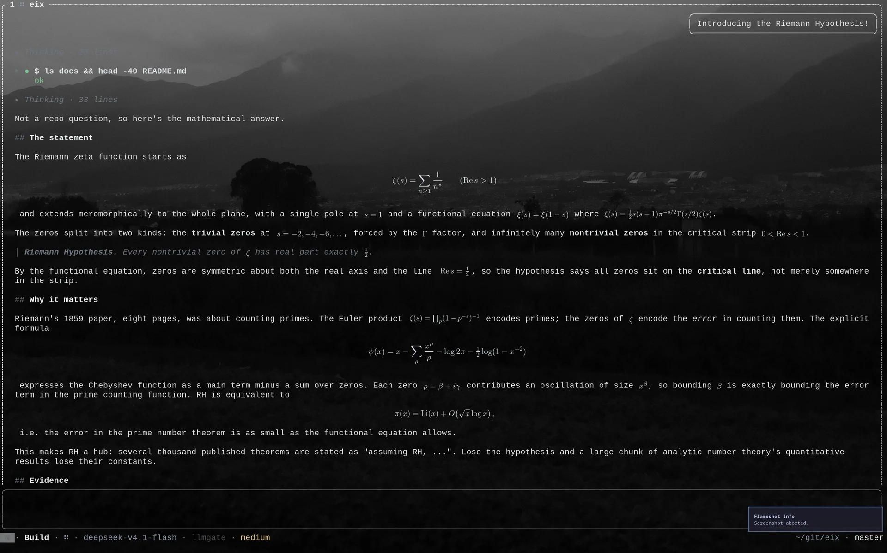
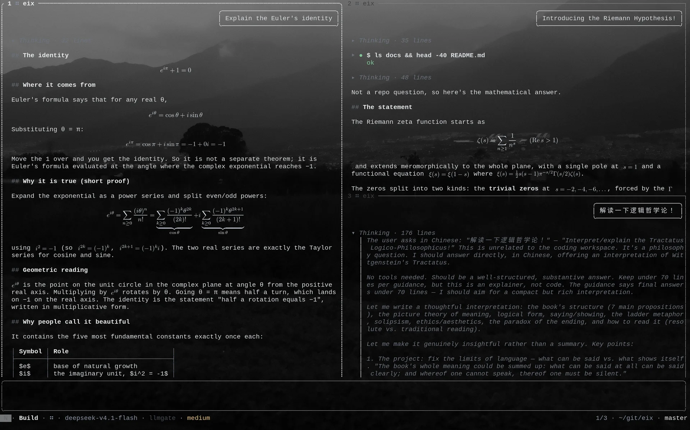
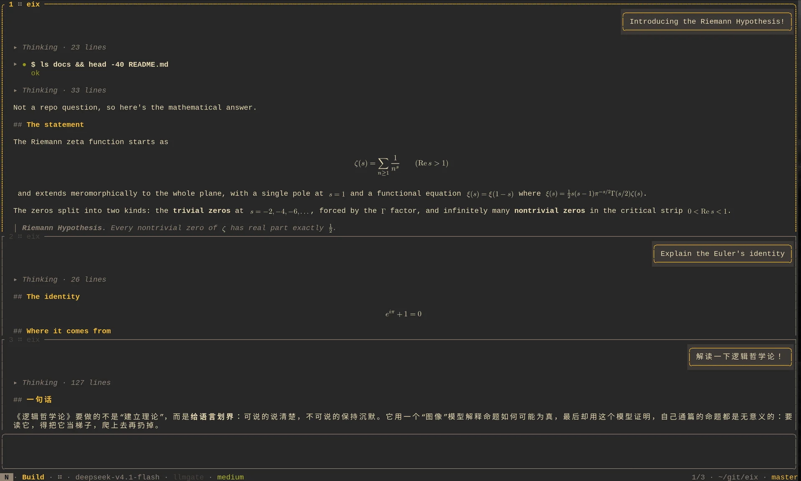
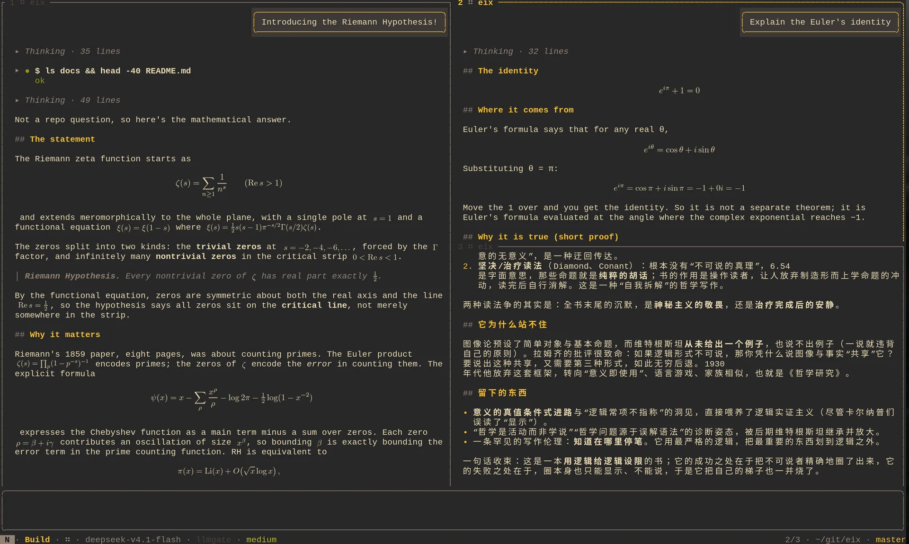

# eix

> A coding agent for vim, dwm, and Arch-style workflows.

<p align="center">
  
  
</p>
<p align="center">
  
  
</p>

<p align="center"><em>Multiple sessions side by side, with LaTeX math rendered inline.</em></p>

`eix` runs a long-lived daemon (`eixd`) plus a frontend (`eix`). Sessions, event logs, tools,
approvals, and context live in the daemon; the TUI, CLI, HTTP/SDK clients, and Neovim are
replaceable frontends. Closing the terminal does not stop a running turn.

[Design](./DESIGN.md) · [Config template](./config.tmpl.toml) ·
[Plugin example](./examples/plugins/echo) · [Plugin design](./docs/plugins.md) ·
[Neovim integration](./docs/nvim.md) · [Protocol contract](./crates/eix-core/src/protocol.rs)

## Highlights

- **Sessions survive the terminal.** `eixd` owns an append-only event log backed by SQLite, so
  sessions persist, attach/detach, and run in parallel. Fork, branch, rewind (conversation and
  files), worktrees, and export/import are built in.
- **Vim input without a subprocess.** The prompt is a native modal editor with motions, operators,
  counts, undo, clipboard-aware yank, leader chords, and comma-separated multi-key bindings.
- **A TUI that shows its work.** Tile multiple sessions across panes (horizontal / tabby /
  Fibonacci), stream Markdown, render LaTeX math as terminal images, review side-by-side diffs,
  and work from fuzzy pickers and an approval inbox.
- **Safety you can inspect and undo.** `plan` / `build` / `auto` / `full` modes, per-call risk
  analysis, bubblewrap sandboxing, hunk-level patch approval, pre-execution snapshots, and secret
  redaction. Rewind restores files as well as conversation.
- **Context and tools that scale.** `AGENTS.md`, workspace summaries, per-sector token budgets,
  automatic compaction, cross-session memory, and on-demand `tool_search`. Built-in tools cover
  patches, shell, plans, web, LSP, images, and sub-agents.
- **Composable from top to bottom.** OpenAI-compatible, Anthropic, Gemini, and DeepSeek providers
  (API key or OAuth); Skills, commands, agents, MCP, and out-of-process plugins; TUI, CLI,
  HTTP/SSE, Rust SDK, TCP, Neovim, and ACP frontends. Worktrees plus `ready` run the
  rebase → test → merge loop.

## Quick start

**Requirements:** Rust stable 1.89+, Cargo, Linux or macOS (Windows is not supported). Optional:
`bwrap` for command sandboxing.

```sh
git clone https://github.com/zetatez/eix.git
cd eix
cargo build --release
./target/release/eix doctor
```

The build produces `eix` (TUI + CLI) and `eixd` (daemon). The daemon starts on the first connection,
runs in its own process group, and survives terminal exit.

### Configure a provider

Exactly one provider sets `default = true`:

```toml
# ~/.config/eix/config.toml
[providers.openai]
default = true
base_url = "https://api.openai.com/v1"
model = "gpt-4o-mini"
api_key_env = "OPENAI_API_KEY"
```

```sh
export OPENAI_API_KEY=...
./target/release/eix
```

For a local endpoint, set `base_url = "http://localhost:11434/v1"` and a local `model`. `kind`
defaults to `openai`; use `kind = "anthropic"`, `"gemini"`, or `"deepseek"` for native protocols.
`[model_roles]` can assign separate `plan` and `execute` models. See
[config.tmpl.toml](./config.tmpl.toml) for every option.

Credential precedence is inline `api_key` → `api_key_env` → `<data_dir>/auth/<provider>.json`.
Manage the last one with `eix auth login|list|logout`; OAuth providers use the same command.
`EIX_BASE_URL`, `EIX_MODEL`, and `EIX_API_KEY` also work for a quick trial.

### First run

```sh
eix                       # TUI; creates a session when none exists
eix chat                  # plain command-line chat
eix send 'explain the session model'
echo 'review the diff' | eix send
eix send --image screenshot.png 'how do I fix this error?'
```

With no session for the current directory, `eix` attaches to the most recent one or creates a new
one. The socket defaults to `$XDG_RUNTIME_DIR/eix.sock`; data lives under the platform data-local
`eix/` directory. Override with `EIX_SOCKET`, `EIX_DATA_DIR`, or `EIX_CONFIG`.

## Core concepts

**Sessions** are append-only event logs of messages, tool calls, approvals, patches, and state.
`fork` copies history; `rewind` also rolls back the workspace from pre-execution snapshots.

**Modes** control what a turn may do:

| Mode    | Capabilities                                                                                       |
| ---     | ---                                                                                                |
| `plan`  | Hard read-only; read-only shell checks only                                                        |
| `build` | Default; workspace-write, with risk/rules deciding direct execution, sandbox, or ask               |
| `auto`  | Workspace-write; unmatched `ask` decisions go to an intent classifier                              |
| `full`  | Removes workspace path limits and allows default asks; hard denials and explicit rules still apply |

**Approvals:** low/medium-risk workspace patches apply directly in `build` mode (snapshots are
kept). Higher-risk patches show a full diff with hunk-level approval. `exec_command` is snapshotted
before execution, and every tool decision is audited.

**Worktrees:** use `eix new --worktree` or `Space W` to isolate a session in `.worktrees/<name>`.
`ready` runs rebase → test → fast-forward merge and resumes the session if it fails.

**Context** is rebuilt from the event log on every request, with per-sector budgets and automatic
compaction. Skills, commands, and agents load on demand; MCP and plugin tools are discovered through
`tool_search`.

## Using eix

### TUI

```sh
eix [--session ID]
```

| Key                               | Action                                                       |
| ---                               | ---                                                          |
| `F1`                              | Searchable help                                              |
| `Ctrl-t`                          | Cycle reasoning effort                                       |
| `Ctrl-/` / `Ctrl-_` / `Ctrl-7`    | Model picker                                                 |
| `Ctrl-p`                          | Command palette                                              |
| `Space o` / `Space h`             | Session picker / input timeline                              |
| `Space f` / `Space s` / `Space g` | File / content / git picker                                  |
| `Space n` / `Space W`             | New session / move into a new worktree                       |
| `Space a` / `Space b`             | Approval inbox / background processes                        |
| `Space v` / `Space t` / `Space r` | Horizontal / tabby / Fibonacci layout                        |
| `Space l` / `Space x`             | Cycle layouts / cancel the turn                              |
| `Tab` / `Shift-Tab`               | Cycle execution mode forward / backward                      |
| `Ctrl-1…9`                        | Focus the Nth open session (kitty keyboard protocol)         |
| `Enter` / `Esc Esc`               | Send or queue the prompt / interrupt or return to transcript |
| `q` / `Z` / `Ctrl-c` / `Ctrl-d`   | Close pane / quit from normal mode / quit from any mode      |

Global, normal, and leader bindings are configurable in `[keys]`; overlay-internal navigation is
fixed. Values may be comma-separated (`quit = "Ctrl-c, Ctrl-d, Z"`), and leader chords use
`new_session = "leader n"`.

Common commands: `/model` and `/model-plan` pin session models, `/rewind` and `/undo` / `/redo`
restore checkpoints, `/context` and `/effort` inspect or adjust the budget, and `/branch`, `/diff`,
`/doctor`, `/goal`, `/loop`, and `/schedule` handle the remaining workflows. `/code-review`,
`/security-review`, `/simplify`, and `/verify` are built-in prompt templates. See the
[implementation reference](./DESIGN.md#19-实现参考) for the full keymap and command list.

### CLI

| Command                                        | Purpose                                  |
| ---                                            | ---                                      |
| `eix tui` / `eix chat` / `eix send`            | TUI / plain chat / one-shot prompt       |
| `eix ls` / `eix log`                           | List sessions / print a transcript       |
| `eix new` / `eix mode`                         | Create a session / switch execution mode |
| `eix fork` / `eix rewind`                      | Copy history / roll back to a checkpoint |
| `eix ready` / `eix integrate` / `eix worktree` | Integration queue and worktrees          |
| `eix approve` / `eix deny` / `eix answer`      | Headless approval handling               |
| `eix ps` / `eix tail` / `eix kill`             | Background processes                     |
| `eix status` / `eix approvals` / `eix pick`    | Scripting and rofi / fzf / dwmblocks     |
| `eix auth` / `eix model` / `eix mcp`           | Credentials, model catalog, MCP OAuth    |
| `eix pair` / `eix acp` / `eix doctor`          | Client pairing, ACP adapter, diagnostics |

Run `eix --help` for the full reference.

### HTTP, SDK, and remote attach

Enable HTTP and/or TCP in `[server]`:

```toml
[server]
http = "127.0.0.1:7778"
tcp = "127.0.0.1:7777"
token = "{env:EIX_TOKEN}"
```

```sh
curl -s localhost:7778/health
curl -s localhost:7778/rpc -H "Authorization: Bearer $EIX_TOKEN" \
  -H 'content-type: application/json' \
  -d '{"id":1,"method":"session.list","params":{}}'
eix --tcp 127.0.0.1:7777 --token "$EIX_TOKEN" tui
```

The API exposes `/health`, `/openapi.json`, `/stats`, `POST /rpc`, and SSE `/events`. Pair a new
client with `eix pair --name laptop`, then `POST /pair` to exchange the one-time code for a token.
Rust projects can use [`eix-sdk`](./crates/eix-sdk); TypeScript projects can use
[`clients/ts`](./clients/ts). See [DESIGN.md](./DESIGN.md) for authentication and event filtering.

### Editors

Neovim plugins connect over the daemon's JSON-RPC; see [docs/nvim.md](./docs/nvim.md). For editors
that support the Agent Client Protocol, `eix acp` runs a stdio adapter:

```json
{ "agent_servers": { "eix": { "command": "eix", "args": ["acp"], "env": {} } } }
```

Sessions, tools, worktrees, MCP, and approvals stay in the daemon. Images, audio, terminal
proxying, and editor-supplied `mcpServers` are not supported yet.

## Configuration

Global files live in `~/.config/eix/`: `config.toml`, `AGENTS.md`, `skills/`, `cmds/`, and
`agents/`. Override the directory with `EIX_CONFIG_DIR`.

Layers, from lowest to highest precedence:

1. `~/.config/eix/config.toml` (or `EIX_CONFIG` / `--config`; an explicit path disables project merging)
2. `.eix/config.toml` in ancestor directories, outer to nearest

Tables merge recursively and arrays replace wholesale. Global/explicit layers expand `{env:NAME}`
and `{file:path}`; project layers do not. Config hot-reloads on mtime changes; a parse failure keeps
the old config and reports `config.error`.

Project layers may only tighten policy: permissive rules are downgraded to `ask`, and they cannot
add plugins, enable compatibility resources, or widen sandbox/network access. Rejected entries
appear in `security_warnings` (`eix doctor`).

Main sections: `providers` / `provider_runtime`, `models` / `model_roles`, `tools`, `context`,
`worktree` / `integration`, `compations`, `mcp` / `plugins`, `images` / `formatter` / `lsp`,
`theme` / `keys` / `notifications`, and `server`. See
[config.tmpl.toml](./config.tmpl.toml) for defaults and comments.

Environment overrides are limited to startup and initial values: `EIX_BASE_URL`, `EIX_MODEL`,
`EIX_API_KEY`, `EIX_SOCKET`, `EIX_DATA_DIR`, `EIX_CONFIG`, `EIX_CONFIG_DIR`, `EIX_CLI_CONFIG`,
`EIX_TCP`, `EIX_TCP_TOKEN`, and `EIX_HTTP`.

## Extensions

| Extension | Mechanism                                                                          |
| ---       | ---                                                                                |
| Skills    | `~/.config/eix/skills/<name>/SKILL.md`, project `.eix/skills/`                     |
| Commands  | `cmds/*.md`; `$ARGUMENTS` / `$1..$9`                                               |
| Agents    | `agents/*.md`; `primary` / `subagent`                                              |
| MCP       | `mcp.servers.<name>`; stdio or Streamable HTTP, lazy startup, `mcp__server__tool`  |
| Plugins   | `plugins.<name>`; `eix-plugin.toml` + JSON-RPC over stdio, or declarative commands |

Compatibility resources are off by default and can only be disabled further by project config.
See [examples/plugins/echo](./examples/plugins/echo) and [DESIGN.md](./DESIGN.md).

## Architecture

```
┌──────────────┐   JSON-RPC / SSE   ┌────────────────────────────┐
│ eix (TUI/CLI)│ ─────────────────> │ eixd                       │
│ external     │ <───────────────── │ sessions / event log       │
│ frontends    │                    │ agent runtime / tools      │
│ HTTP / SDK   │                    │ approvals / context / git  │
└──────────────┘                    └────────────────────────────┘
```

```
crates/
├── eix-core   Shared types: sessions, events, protocol, config, risk analysis
├── eixd       Daemon: session registry, SQLite, agent runtime, tools, MCP, plugins
├── eix-sdk    Typed Rust client for HTTP JSON-RPC / SSE
└── eix-tui    `eix` frontend: TUI + chat / send / log / picker CLI
```

`crates/eix-core/src/protocol.rs` is the protocol contract. Design decisions and the full
implementation reference live in [DESIGN.md](./DESIGN.md).

## Build and develop

```sh
make release                  # current OS/arch + native package
make dist                     # all supported formats for this OS
cargo fmt --all -- --check
cargo clippy --workspace --all-targets -- -D warnings
cargo test --workspace
```

Requires Rust stable, `cargo`, and `make`. Packaging needs `dpkg-deb` on Debian/Ubuntu;
macOS packages must be built on macOS. Artifacts go to `dist/`. CI runs the same checks on Linux
and macOS, verifies the 1.89 MSRV, and builds releases for Linux x86_64/aarch64, macOS Intel/Apple
Silicon, and Arch x86_64. When changing the protocol, update
`crates/eix-core/src/protocol.rs` and [DESIGN.md](./DESIGN.md).

The core loop is usable: daemon, SQLite event log, streaming providers, the multi-pane TUI, the
built-in Vim editor, tools and approvals, sandbox/snapshot/patch writes, automatic context,
fork/rewind, worktrees, the integration queue, sub-agents, MCP, plugins, Skills, HTTP/SDK, remote
TCP, and the Neovim protocol surface. See the
[implementation status](./DESIGN.md#20-实现状态) for the complete checklist.

## License

MIT
